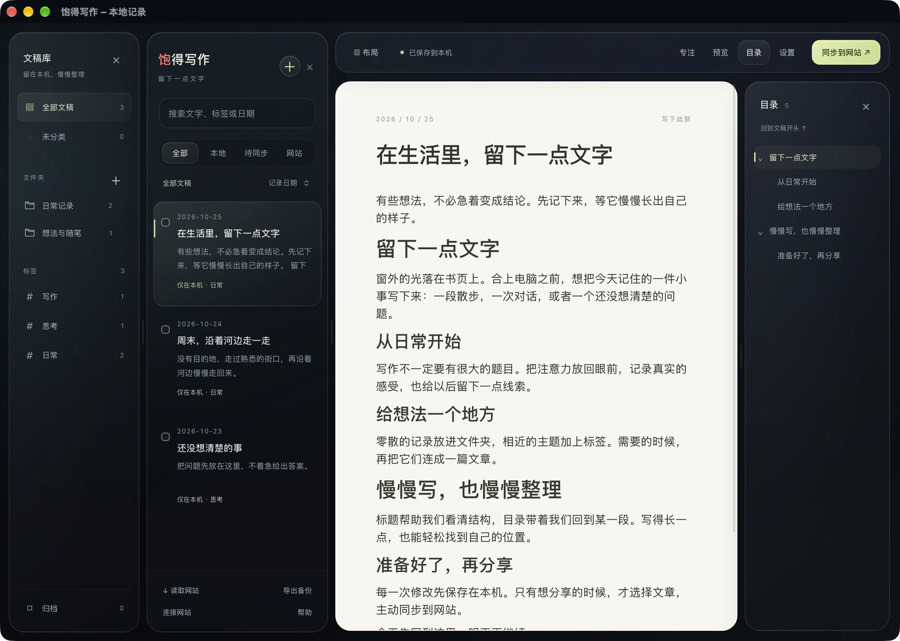

# 饱得写作 · BaodeWriter

把生活，慢慢写下来。

一个留在 Mac 上的写作角落。记一点日常，写一篇长文，把想法慢慢整理。断网也能写，准备好了再分享。

**[产品介绍](https://writer.baode.life/)** · **[下载 Mac 版](https://github.com/cainebaode/BaodeWriter/releases/tag/v0.1.0)** · [使用帮助](https://writer.baode.life/help/) · [隐私说明](https://writer.baode.life/privacy/)



## 可以做什么

- 本地优先的写作、图片保存与离线使用。
- 文件夹、标签、搜索、记录日期及修改时间管理。
- 分级文章目录、点击跳转、专注模式，可调宽和隐藏的分栏。
- 原始文稿与图片备份、恢复前安全副本。
- 主动选择后同步文章及图片，失败重试、重复同步不重建，冲突保留双方。

首版的网站同步对接作者的 baode.life，需要该站管理员权限。暂不支持任意博客；本地写作和备份不需要账号。

## 安装

要求 macOS 13 或更新版本。Universal 安装包包含 Apple Silicon 和 Intel 架构；实际运行验证使用 Apple Silicon，Intel 已完成编译与架构检查。

1. 在 Releases 下载 DMG，打开并把「饱得写作」拖到「应用程序」。
2. 当前为个人使用预览版，采用本地签名，尚未经过 Apple 公证。首次启动可能被 macOS 阻止，请先阅读[安装帮助](https://writer.baode.life/help/#install)及其中的 Apple 官方说明。
3. 新建文稿，看到「已保存到本机」即可关闭。更新前退出应用，再覆盖安装；数据独立于应用包保存。

公开资产附 SHA-256 校验文件。当前手动下载更新，没有自动更新服务。

## 使用与反馈

完整说明见[使用帮助](https://writer.baode.life/help/)。请在 Issues 附版本、macOS 版本和复现步骤，不要上传私人文稿、备份、密码或登录信息。

## 从源码构建

本仓库公开完整 Mac 应用工程。0.1.0 的固定源码为 [`v0.1.0-source`](https://github.com/cainebaode/BaodeWriter/tree/v0.1.0-source)，[版本页](https://github.com/cainebaode/BaodeWriter/releases/tag/v0.1.0)另附 `BaodeWriter-0.1.0-source.tar.gz` 与 `SOURCE-SHA256SUMS.txt`。

需要 macOS 13+、可用的 Xcode Command Line Tools（Swift / macOS SDK）、Node.js 22 和 npm。以下命令在工程根目录执行：

```sh
git clone https://github.com/cainebaode/BaodeWriter.git
cd BaodeWriter
git checkout v0.1.0-source
npm ci
npm run build
```

完整构建依次执行类型检查、13 项前端数据模型测试、前端打包、第三方许可归集、41 项原生自测，以及双架构编译和安装包生成。输出为 `dist/饱得写作.app`、`dist/BaodeWriter-0.1.0-universal.dmg` 和 `dist/SHA256SUMS.txt`；不会安装应用或访问正式文稿库。

`web/` 是 React / BlockNote 编辑界面；`native/` 是 Swift / AppKit / WebKit 外壳、本地存储及网络桥接；`scripts/` 负责打包与许可审核。存储、桥接和隔离测试细节见 [native/README.md](native/README.md)。本机文稿目录为 `~/Library/Application Support/BaodeWriter/`，与源码目录分开。自行构建后首次试运行可指定临时文稿目录：

```sh
dist/饱得写作.app/Contents/MacOS/BaodeWriter --data-dir /tmp/baodewriter-source-demo
```

仓库不含私人文稿、登录会话、服务器配置或个人网站的服务端工程。网站同步需要已兼容的 BaodeLife 接口与管理员登录，单独构建此客户端不会创建网站后台。[SOURCE-PROVENANCE.json](SOURCE-PROVENANCE.json)记录本次公开的构建输入及原安装包摘要；重新构建会受到文档、签名和时间戳影响，不承诺与已发布 DMG 逐字节相同。

## 源码公开与第三方许可

应用自有源码现已公开供查看；作者尚未为自有代码选择额外的开源许可证，公开源码不等于授予任意再分发或商业使用许可。GitHub 平台条款及第三方各自许可不受影响。品牌名称、图标和演示素材也不因源码公开而额外授权。许可选择以仓库后续明确声明为准。

第三方组件遵循各自许可证。安装包的 `Contents/Resources/licenses/` 包含完整声明及 BlockNote 0.31.3 受 MPL 覆盖的对应源码。Releases 同时提供 `Third-Party-Licenses-0.1.0.tar.gz`，无需安装应用即可获取。未采用 BlockNote XL。详情见 [LICENSES.md](LICENSES.md) 与 [THIRD-PARTY-NOTICES.md](THIRD-PARTY-NOTICES.md)。
